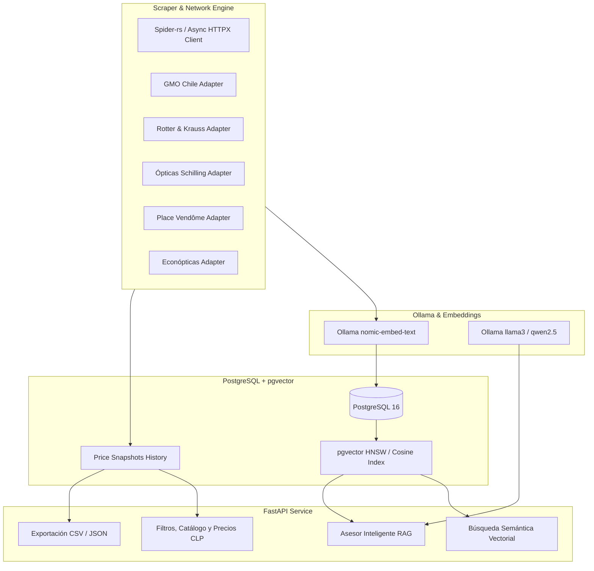

# 👓 Chilean Optics Scraper, pgvector & Ollama AI API

[](https://github.com/MargonDiego/opticas-chile-scraper/actions/workflows/ci.yml)
[](https://www.python.org/)
[](https://github.com/astral-sh/uv)
[](https://github.com/pgvector/pgvector)
[](https://ollama.com)
[](https://opensource.org/licenses/MIT)

A high-performance web scraper, vector search, and AI assistant REST API for tracking, comparing, and semantically querying optical products across major retail chains in Chile.

Powered by **[`uv`](https://github.com/astral-sh/uv)**, **PostgreSQL with `pgvector`**, **[`Ollama`](https://ollama.com)** for local LLM recommendations & embeddings, and **FastAPI**.

---

## 🏬 Cadenas de Ópticas Cubiertas en Chile

| Tienda | Dominio | Plataforma | Categorías Objetivo |
| :--- | :--- | :--- | :--- |
| **GMO Chile** | `gmo.cl` | Luxottica Enterprise / Custom | Lentes de Sol, Ópticos, Contacto |
| **Rotter & Krauss** | `ryk.cl` / `rotterandkrauss.cl` | GrandVision / VTEX / Shopify | Lentes de Sol, Ópticos, Contacto |
| **Ópticas Schilling** | `schilling.cl` | VTEX / Custom | Lentes de Sol, Ópticos, Contacto |
| **Place Vendôme** | `opv.cl` / `placevendome.cl` | VTEX / Custom | Armazones de Diseño, Sol, Cristales |
| **Econópticas** | `econopticas.cl` | VTEX | Lentes Económicos, Sol, Contacto |

---

## 🏗️ Arquitectura del Sistema



---

## 🚀 Inicio Rápido (Desarrollo Local)

### 1. Clonar e Instalar dependencias con `uv`
```bash
git clone https://github.com/MargonDiego/opticas-chile-scraper.git
cd opticas-chile-scraper

# Sincronizar entorno virtual
uv sync
```

### 2. Ejecutar Tests
```bash
uv run pytest -v
```

### 3. Levantar la API localmente
```bash
uv run uvicorn src.main:app --reload --port 8000
```
Documentación Swagger disponible en [http://localhost:8000/docs](http://localhost:8000/docs).

---

## 🌐 Endpoints Principales de la API

| Método | Endpoint | Descripción |
| :--- | :--- | :--- |
| `GET` | `/api/health` | Estado del sistema, PostgreSQL y conexión a Ollama. |
| `GET` | `/api/products` | Filtros por tienda, marca, categoría, rango de precios en CLP y texto. |
| `GET` | `/api/products/{id}` | Ficha técnica con historial completo de variaciones de precio. |
| `POST` | `/api/products/search/semantic` | **Búsqueda Semántica Vectorial** con pgvector + Ollama. |
| `POST` | `/api/advisor/chat` | **Asesor Inteligente RAG** potenciado por Ollama LLM. |
| `POST` | `/api/scrape/trigger` | Disparar scraping en background por tienda o todas. |
| `GET` | `/api/scrape/jobs` | Historial y estado de jobs de scraping. |
| `GET` | `/api/export/csv` / `.json` | Descarga de datasets completos en CSV o JSON. |
| `POST` | `/api/admin/embeddings/reindex` | Re-indexación por lotes de embeddings (requiere admin key). |

---

## Embedding text and re-indexing

Product vectors are built from a single source of truth:
`src/services/embedding_text.py::build_embedding_text`. The composed text is,
in order:

1. `brand`
2. `model_name`
3. `category`
4. the store display name (e.g. `gmo` -> `GMO Chile`)
5. `description` with HTML tags stripped

Whitespace is collapsed to single spaces, empty parts are dropped, and the
result is truncated at `MAX_EMBEDDING_TEXT_CHARS` (1200) on a word boundary.
`nomic-embed-text` accepts far more than the old 150-character limit, so the
*intent* is to keep enough context for a descriptive query (for example
`"armazon infantil"`) to match a product whose evidence only says
`"Polaroid Kids (4-8 años)"`. That is a hypothesis, not a measured result: it
has **not** been validated against a populated catalog, and it must be checked
with `tools/eval_search.py` (see below) after a re-index before anyone relies on
it. The scraper and the re-index compose this string from the same fields for
the same row (the scraper embeds the value it is about to persist), so both
writers of the vector column agree.

**Changing the composition invalidates every stored embedding.** After any edit
to that module, re-index the catalog with a keyset cursor and page until `done`
is true:

```bash
# First batch: no cursor.
curl -s -X POST "$BASE_URL/api/admin/embeddings/reindex?limit=100" \
  -H "X-API-Key: $ADMIN_API_KEY"
# Then repeat with after_id=<next_cursor> from the previous response.
```

Response contract:

```json
{
  "processed": 100,
  "updated": 100,
  "failed_no_text": 0,
  "failed_embedding": 0,
  "remaining": 812,
  "next_cursor": "gmo:3311",
  "done": false
}
```

- `after_id` is an **exclusive keyset cursor**: `id > after_id ORDER BY id
  LIMIT limit`. There is no `offset`; keyset paging cannot re-read or skip a
  page when rows are inserted or deleted mid-run.
- `next_cursor` is the last product id **attempted** in the batch, so the
  caller always advances, even when some rows failed and stayed `NULL`.
- `updated` is the UPDATE rowcount, so a row deleted between the read and the
  write phase is not counted.
- `remaining` is a real `COUNT(*)` taken **after** the batch is written, and
  `done` is exactly `remaining == 0`. With `only_missing=true` it counts rows
  that still have no embedding (a row that keeps failing keeps `done` false);
  in a full sweep it counts the rows ahead of the cursor.
- A batch with `processed == 0` while `remaining > 0` means the scan is
  exhausted and the leftovers keep failing: stop and read the per-row warnings.

A response with `503` means the embedding service is unreachable: **no**
embeddings were written for that batch, and the operator must fix Ollama
(`OLLAMA_BASE_URL`) and retry the same cursor. A `500` means the batch could not
be persisted; nothing was committed, so retry the same cursor. Empty embedding
text is not an outage: it returns `200` and is counted in `failed_no_text`.

Each batch reads a page of products, releases the database connection, calls
Ollama, then persists the vectors through a second short-lived session, so a
long re-index never pins a pooled connection. Concurrent runs are rejected with
`409`, the run lock is released on every exit path, and every batch logs a
summary line.

Backfill products whose embedding is still `NULL` (for example after enabling
pgvector on an existing catalog) with `only_missing=true` and the same cursor
loop:

```bash
curl -s -X POST "$BASE_URL/api/admin/embeddings/reindex?only_missing=true&limit=100" \
  -H "X-API-Key: $ADMIN_API_KEY"
```

`similarity_score` in semantic search responses is `1 - cosine_distance`
(clamped to `[0.0, 1.0]`, 4 decimals) for rows from the vector candidate set,
and `null` for lexical-only results (a `NULL` distance is never coerced to a
score). To check ranking quality against a live deployment (read-only; exit
code 1 means at least one case failed, and transport errors / `401` / malformed
payloads are reported as FAIL rows, not tracebacks):

```bash
BASE_URL=http://localhost:8000 API_KEY=... uv run python tools/eval_search.py
```

The harness is the gate for the embedding-text change: it verifies the kids
query keeps returning kids frames **and** that at least 80% of those results
carry a non-null `similarity_score` (which is what proves the vector path, not
just lexical matching, produced them), plus a mean-similarity floor that fails
if every score comes back null.

---

## 🐳 Despliegue en Homelab con Coolify (`192.168.1.85`)

El proyecto incluye `docker-compose.yml` con **PostgreSQL + pgvector** (`pgvector/pgvector:pg16`) y conexión directa al **Ollama** de tu servidor.

Consultá la guía completa en **[DEPLOY_COOLIFY.md](DEPLOY_COOLIFY.md)**.

---

## 📄 Licencia
Distribuido bajo la Licencia MIT.